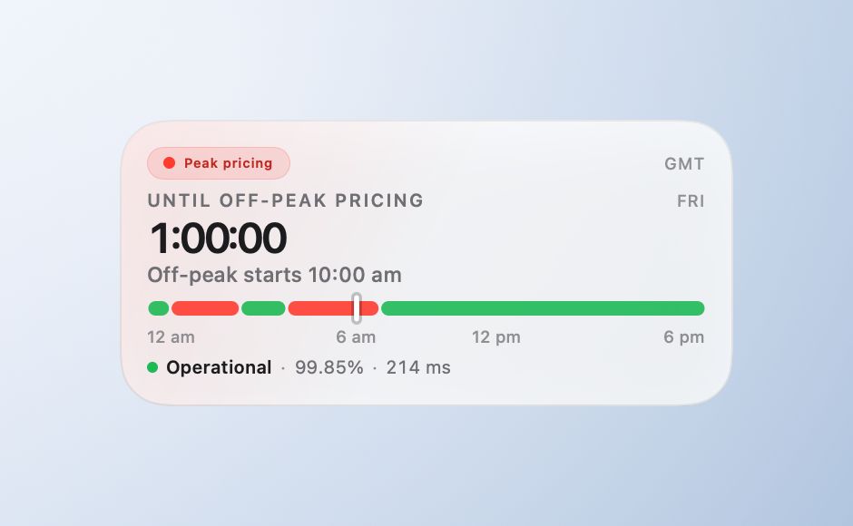

# DeepSeek Tracker

A small macOS desktop widget with one job: **how long until DeepSeek's API goes
off-peak (half price)**.



## What it does

- **Big countdown** to the next price change — `1:00:00`, or `52:08:07` when the
  weekend is in the way. Hours never wrap into days, so you always see the real wait.
- **Peak or off-peak at a glance** — red "Peak pricing" or green "Off-peak · half price",
  plus the switch time in your own time zone (`Peak starts Mon 11:30 am`).
- **Schedule bar** — the day's peak/off-peak windows drawn in your local time
  (12 am · 6 am · 12 pm · 6 pm) with a notch at "now". It is labelled with the day it
  shows, so a green Saturday reads `SAT · OFF-PEAK ALL DAY` instead of looking broken.
- **All three services at a glance** — Pro, Flash and Chat status dots in the header,
  read live from https://status.deepseek.com/. No API key, no background process.
- **Incident alerts** — when DeepSeek posts an incident ("investigating", "fix applied,
  monitoring"), the card shows it as an event with its age and keeps showing it until the
  status page clears it back to operational.
- **Coverage while it lasts** — the incident row shows the latest state and how long it
  has been running; the pill, dots and countdown never depend on the network.
- **Three sizes, light and dark** — small (countdown + switch time), medium (adds the
  schedule bar and metrics), large (bigger type, service count and incidents).
- **Works offline** — the countdown is computed locally; only the metrics row needs the
  network, and it degrades to `Metrics offline` rather than breaking.

## Install

A built, locally-signed copy is included in `dist/`:

1. Double-click **`dist/Install DeepSeek Tracker.command`** — it copies the app to
   `/Applications`, clears any stale widget registrations, and opens it.
2. Right-click the desktop → **Edit Widgets…**
3. Search **DeepSeek Tracker** and drag the size you want onto the desktop.

If macOS blocks the app the first time, right-click it → **Open** (it's signed
"to run locally", not notarized). Widgets only appear from an app that is in
`/Applications` and has been launched once.

Optional extras (90-day uptime and your API balance):

```bash
node collector/status-collector.mjs --serve 8787 --interval 60
```

## Build from source

Requires macOS 14+ and Xcode 27 (Swift 6).

```bash
# debug build
xcodebuild -project native/DeepSeekTracker.xcodeproj -scheme DeepSeekTracker \
  -configuration Debug -derivedDataPath .tmp/dd build

# or make the installable package in dist/ (Release + signing + installer)
./tools/package.sh
```

You can also open `native/DeepSeekTracker.xcodeproj` in Xcode, pick your team under
*Signing & Capabilities* (a free Personal Team is enough), and press **Run**. Note that
macOS resolves a widget by bundle id — run the app from `/Applications`, not from a
build folder, or the gallery may show a stale copy.

```bash
./tools/verify.sh    # vectors, collector tests, Swift tests, Xcode build
./tools/render-shots.sh   # regenerate the screenshots in artifacts/screens
```

## Peak windows (2026 rules)

All windows are fixed in **UTC**:

| | UTC | Beijing |
| --- | --- | --- |
| Peak | 01:00–04:00 and 06:00–10:00 | 09:00–12:00 and 14:00–18:00 |
| Off-peak | everything else, at half price | — |

Since 2026-08-23 00:00 Beijing (2026-08-22T16:00Z), **Saturdays, Sundays and Chinese
public holidays are off-peak all day** — no peak window runs then. Included holidays:
Mid-Autumn 2026-09-25→27, National Day 2026-10-01→07.

## Repo layout

```
native/            SwiftUI app + WidgetKit extension
  DeepSeekCore/    peak clock, pricing, metrics models — 41 unit tests
collector/         optional zero-dependency metrics collector — 54 tests
spec/              peak-window rules, reference implementation, test vectors
tools/             package.sh, render-shots.sh, generate-project.rb, verify.sh
docs/              native build notes, metrics schema, Swift core API
artifacts/screens/ screenshots used above
dist/              built app + installer (generated by tools/package.sh)
```

The Swift core and the reference implementation are pinned to the same
`spec/vectors.json`, so the countdown and the schedule bar always agree.

## License

MIT — see [LICENSE](LICENSE). Use it, fork it, reskin it. DeepSeek's pricing rules
and the peak/off-peak schedule belong to DeepSeek; the rate card is quoted from
their public pricing page and is not guaranteed to stay accurate.
