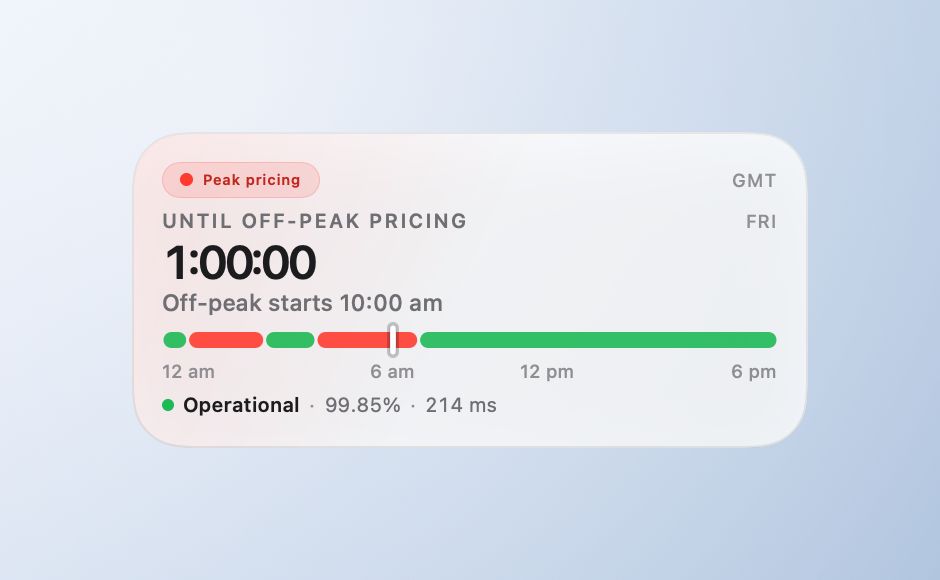

# Native macOS widget

A SwiftUI app plus a WidgetKit extension. One card, three families, light and dark.
The countdown is the hero; everything else is quiet.



## Build

```bash
# debug build (Xcode's "sign to run locally")
xcodebuild -project native/DeepSeekTracker.xcodeproj -scheme DeepSeekTracker \
  -configuration Debug -derivedDataPath .tmp/dd build

# ready-to-install package in dist/ (Release + ad-hoc signing + installer)
./tools/package.sh
```

`tools/package.sh` rebuilds the project, re-signs the widget extension with its
sandbox + network entitlements (needed so a widget can talk to `127.0.0.1`), signs the
app "to run locally", and writes `dist/DeepSeek Tracker.app`,
`dist/Install DeepSeek Tracker.command` and `dist/README.txt`.

## Install

1. Double-click `dist/Install DeepSeek Tracker.command` (copies to `/Applications`, opens once).
2. Right-click the desktop → **Edit Widgets…** → search **DeepSeek Tracker**.

Widgets are only registered from an app that lives in `/Applications` and has been
launched once. If it doesn't show up immediately, keep the app open a few seconds and
reopen the gallery, or log out/in.

## Structure

```
native/
├── DeepSeekTracker.xcodeproj     generated by tools/generate-project.rb
├── App/                          @main app, preview + install checklist
├── Widget/                       WidgetKit bundle + timeline provider
│   ├── DeepSeekTrackerWidget.swift
│   ├── Info.plist                NSExtension = com.apple.widgetkit-extension
│   └── DeepSeekTrackerWidget.entitlements   app-sandbox + network.client
├── Shared/
│   ├── DesignSystem.swift        palette (light/dark), sizes, card chrome
│   ├── TrackerCard.swift         the whole card: header, countdown, bars, incident row, metrics
│   ├── DeepSeekStatus.swift      status-page parser (services + active incident) + latency probe
│   ├── DisplayZone.swift         localised labels against a UTC offset
│   └── MetricsStore.swift        localhost fetch + observable store
└── DeepSeekCore/                 Foundation-only models, tested with SwiftPM
```

The `DeepSeekCore` sources are compiled into both targets directly (no package link).
Run their tests with:

```bash
cd native/DeepSeekCore
export TMPDIR="$PWD/../../.tmp/hc" CLANG_MODULE_CACHE_PATH="$PWD/../../.tmp/mc"
swift test --disable-sandbox --cache-path ../../.tmp/cc --scratch-path ../../.tmp/cc
```

## Behaviour

* The widget refreshes its timeline at the next price switch (and at most every 15
  minutes), so the pill flips when pricing does.
* The countdown is a `Text(timerInterval:)` — the system ticks it every second without
  a timeline refresh.
* While off-peak the headline reads **UNTIL PEAK PRICING**; while peak it reads
  **UNTIL OFF-PEAK PRICING**. Either way the number is time to the next price change.
* Status: `DeepSeekStatus` parses the status page's embedded JSON payload and reads its
  `active_changes` array — the three services (Pro / Flash / Chat) with their current
  status, plus the live incident (title, state, start time, affected services). While an
  incident is listed, the card shows it as an event and keeps showing it until the page
  removes it (i.e. until it is operational again). Latency is three timed requests to
  `api.deepseek.com`; the optional collector on `:8787` adds 90-day uptime and balance.
* The schedule bar draws `PeakClock.displaySegments` for the display zone — peak windows
  in red/amber, off-peak in green — with a white notch at the current minute. The second
  widget kind (**DeepSeek Tracker · 24h**) adds a thin bar for the rolling next 24 hours,
  built from `PeakClock.nextSwitches`. Both kinds are plain `StaticConfiguration`s — no
  AppIntent — so they load with an ad-hoc signature.

## Troubleshooting

* **Widget missing from the gallery** — app must be in `/Applications`, launched once,
  and signed (ad-hoc is enough for local use; `tools/package.sh` does it). Re-run the
  installer if you replaced the app.
* **`Metrics offline`** — start the collector: `node collector/status-collector.mjs --serve 8787 --interval 60`.
* **App blocked by Gatekeeper** — right-click the app → Open, or
  `xattr -dr com.apple.quarantine "/Applications/DeepSeek Tracker.app"`.
* **Macro plugin error while building** — the project sets `OTHER_SWIFT_FLAGS = -disable-sandbox`
  because the Swift macro plugin server can't nest a sandbox here; keep that flag.
* **Regenerate the project** — `GEM_HOME=$PWD/.tmp/gems GEM_PATH=$PWD/.tmp/gems ruby tools/generate-project.rb`.
